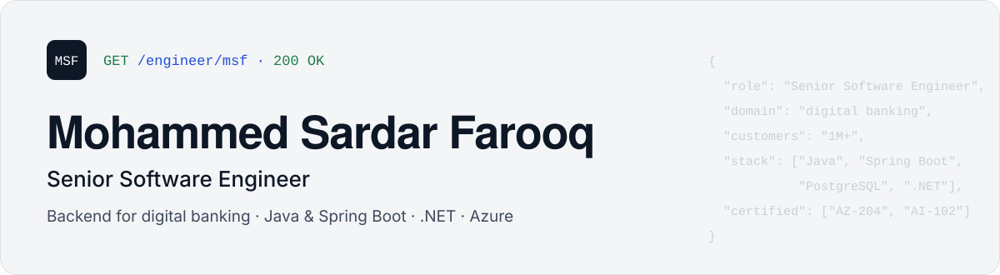

<picture>
  <source media="(prefers-color-scheme: dark)" srcset="assets/header-dark.svg">
  <source media="(prefers-color-scheme: light)" srcset="assets/header-light.svg">
  
</picture>

**Senior Software Engineer** at Tailored Applications · Erbil, Iraq

I build backend systems that banks can rely on. For more than three years I've worked on [First Iraqi Bank](https://fib.iq/en), Iraq's first licensed digital bank, serving over a million customers.

[Portfolio](https://mahamad-sardar.azurewebsites.net) · [LinkedIn](https://linkedin.com/in/mahamad-sardar) · [Email](mailto:mahamadsardarf@gmail.com) · [Résumé](https://mahamad-sardar.azurewebsites.net/pdfs/Mohammed_Sardar_Farooq.pdf)

### `GET /about`

Backend developer at heart: Java, Spring Boot and PostgreSQL microservices in a hexagonal architecture. My career started in C# and .NET, and I'm Microsoft certified on Azure as a Developer and AI Engineer Associate. I care about clean architecture, tested code and systems that stay easy to change, and I enjoy helping junior developers grow through code reviews.

### `GET /experience`

| Company | Role | Dates |
| :-- | :-- | :-- |
| **Tailored Applications** | Senior Software Engineer | Aug 2026 – Present |
| **Gateway for ICT Solutions** | Backend Developer | Jul 2023 – Jul 2026 |
| **Shift Software** | Software Engineer Intern | Jul 2022 – Aug 2022 |

### `GET /stack`

| Area | Tools |
| :-- | :-- |
| **Languages** | `Java` `C#` `SQL` |
| **Backend** | `Spring Boot` `Spring Security` `Spring Data` `Apache Camel` `Keycloak` `ASP.NET Core` `EF Core` |
| **Architecture** | `Microservices` `Hexagonal` `CQRS` `Vavr` |
| **Data & messaging** | `PostgreSQL` `SQL Server` `Liquibase` `RabbitMQ` `Redis` |
| **Testing** | `JUnit` `Mockito` |
| **Cloud & DevOps** | `Azure` `GitHub Actions` `Git` `Gradle` |

### `GET /projects`

**[First Iraqi Bank](https://fib.iq/en)** · Gateway for ICT Solutions → Tailored Applications  
Backend for Iraq's first licensed digital bank, serving more than a million customers. Microservices in a hexagonal architecture, connected to the core banking system.  
`Java` `Spring Boot` `Spring Security` `PostgreSQL` `Keycloak` `Apache Camel`

### `GET /certifications`

- **AI-102** · [Azure AI Engineer Associate](https://learn.microsoft.com/api/credentials/share/en-us/MahamadSardar-9540/AD064FC33625B786?sharingId=E4EC4F8154DC4A59) · Microsoft · Jun 2025
- **AZ-204** · [Azure Developer Associate](https://learn.microsoft.com/api/credentials/share/en-us/MahamadSardar-9540/4AD0F903C52FD06E?sharingId=E4EC4F8154DC4A59) · Microsoft · Feb 2024
- **AZ-900** · [Azure Fundamentals](https://www.credly.com/badges/799b0914-144c-4d1a-827e-3534be486d99) · Microsoft · Sep 2022

### `GET /activity`

  

  
  

### `POST /contact`

Building something in banking, backend or cloud? Let's talk: **mahamadsardarf@gmail.com**
